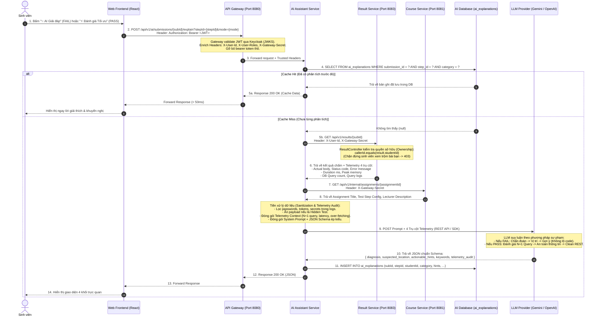

# ĐẶC TẢ THIẾT KẾ TÍCH HỢP AI TRONG HỆ THỐNG WEB GRADING SYSTEM
## (Trọng tâm: AI Trợ giảng Thông minh & Đánh giá Toàn diện Chất lượng Mã nguồn cho Sinh viên)

> **Mục đích tài liệu:** Tài liệu đặc tả tổng thể thiết kế tính năng AI trong hệ thống Web Grading System, bao gồm: phân tích hiện trạng dữ liệu thực tế từ mã nguồn, 4 trụ cột Telemetry chuyên sâu, thiết kế Schema Database, Sequence Diagram chuẩn hóa theo kiến trúc Microservices và các mẫu DTO phản hồi.  
> **Lưu ý phạm vi:** *Phần AI Copilot Agent hỗ trợ Giảng viên biên soạn bài tập tạm thời được hoãn lại (Post-MVP) để nghiên cứu và phát triển ở giai đoạn sau. Trọng tâm giai đoạn hiện tại tập trung 100% vào trải nghiệm học tập và hỗ trợ Sinh viên.*

---

## 1. TỔNG QUAN ĐỊNH HƯỚNG TÍCH HỢP AI

Hệ thống **Web Grading System** hiện tại đã hoàn thiện động cơ chấm điểm tự động đa tầng (Black-box Testing trên môi trường Docker Sandbox với 4 loại Test Steps: `HTTP_REQUEST`, `DB_QUERY`, `DB_SCHEMA_CHECK`, `DB_MIGRATION`). 

Trong giai đoạn này, hệ thống ưu tiên toàn lực cho bài toán cốt lõi:
* **Nâng cấp từ "Chấm điểm cơ học" thành "Nền tảng Học tập Thông minh" cho Sinh viên:** 
  * Không chỉ giải thích nguyên nhân cốt lõi khi bài làm bị **FAIL** (Root-cause Debugging có tính sư phạm, chỉ ra nguyên nhân và vị trí nghi vấn, đưa gợi ý định hướng thay vì viết sẵn mã nguồn cho chép).
  * **Tính năng đột phá:** Đánh giá chất lượng mã nguồn và khuyến nghị tối ưu ngay cả khi bài làm đã **PASS** (Phát hiện lỗi N+1 Query trong ORM, Over-fetching làm lộ dữ liệu nhạy cảm, vi phạm chuẩn RESTful, chạy chậm sát nút Timeout, hoặc nghi vấn hardcode chuỗi trả về để qua bài).
* *(Kế hoạch tương lai - Phase 2)*: Nghiên cứu mô hình Interactive AI Agent giúp Giảng viên biên soạn tự động kịch bản test và đề bài.

---

## 2. [TẠM HOÃN - PHASE 2] PHẦN DÀNH CHO GIẢNG VIÊN: AI COPILOT BIÊN SOẠN BÀI TẬP

> [!NOTE]
> **TRẠNG THÁI: TẠM HOÃN (DEFERRED / POST-MVP)**  
> Phần tính năng này tạm thời chưa hiện thực hóa trong giai đoạn hiện tại. Toàn bộ thiết kế dưới đây được lưu lại làm tài liệu định hướng nghiên cứu tiếp theo sau khi hoàn thiện xong cụm tính năng AI dành cho Sinh viên.

### 2.1 Vấn đề thực tế
Một bài tập Web/Backend hoàn chỉnh có cấu hình rất phức tạp: phải khai báo chính xác HTTP Method, Headers, Request Body JSON, Expected Status, SQL Query kiểm tra DB, Schema Table/Column, trọng số điểm, timeout... Việc nhập tay từng trường trên form tiêu tốn của giảng viên từ 30 – 60 phút mỗi bài.

### 2.2 Mô hình thiết kế: "Split-Screen Copilot Workspace" (Hội thoại lặp + Live Canvas)
Thay vì một Chatbot popup đơn giản (chỉ trả về text và bắt giảng viên copy-paste), hệ thống sử dụng không gian làm việc chia đôi màn hình:

```
+------------------------------------------+------------------------------------------+
|  CỘT TRÁI: HỘI THOẠI VỚI AI (Chat Panel)  | CỘT PHẢI: BẢN NHÁP TRỰC TIẾP (Live Canvas)|
+------------------------------------------+------------------------------------------+
|                                          | Tên bài: Quản lý Thư viện Sách           |
| 🧑 Giảng viên (Lượt 1):                   | Cổng: 8080 | DB: PostgreSQL             |
| Tạo bài tập CRUD Sách, kiểm tra cả DB.   | ---------------------------------------- |
|                                          | 📋 Test Plan 1: Quản lý Sách (4 Steps)   |
| 🤖 AI Copilot:                           |                                          |
| Đã tạo 4 test steps cơ bản ở bản nháp.  |  [Step 1] HTTP POST /books (Tạo mới)     |
|                                          |           Expect: 200 OK                 |
| ---------------------------------------- |  [Step 2] HTTP GET /books (Xem danh sách)|
| 🧑 Giảng viên (Lượt 2 - Prompt tinh chỉnh): | [Step 3] DB_QUERY: Kiểm tra bảng books |
| Ở Step 1 sửa lại kỳ vọng 201 Created.    |  [Step 4] HTTP DELETE /books/1           |
| Thêm 1 step kiểm tra lỗi nếu thiếu tên. |                                          |
|                                          | *(Cập nhật Real-time - Những thay đổi    |
| 🤖 AI Copilot:                           |  được highlight để giảng viên nhận biết)*|
| Đã đổi Step 1 thành 201 và bổ sung thêm  |                                          |
| Step 5 kiểm tra Bad Request (400).       |  [Step 1] HTTP POST /books -> 201 Created|
|                                          |  [Step 5] HTTP POST /books (Thiếu name)  |
|                                          |           Expect: 400 Bad Request (MỚI)  |
| ---------------------------------------- | ---------------------------------------- |
| [ Nhập yêu cầu chỉnh sửa tiếp...    ] 🚀 | [✏️ Sửa tay]   [✅ Áp dụng vào Bài tập] |
+------------------------------------------+------------------------------------------+
```

### 2.3 Quy trình tương tác (Human-in-the-loop Workflow)
1. **Khởi tạo (Turn 1):** Giảng viên nhập yêu cầu bằng tiếng Việt hoặc upload file PDF đề bài / OpenAPI Swagger / Postman Collection $\rightarrow$ AI Agent sinh ra bản nháp ban đầu sang Cột Phải.
2. **Tinh chỉnh lặp (Multi-turn Prompting):** Giảng viên có thể ra lệnh tiếp tục cho AI:
   * *"Đổi tên bảng trong câu query DB ở Step 3 từ `tbl_books` thành `books`."*
   * *"Thêm 2 test cases biên: 1 cái gửi thiếu author thì báo 400, 1 cái tìm ID không tồn tại báo 404."*
   * *"Tăng timeout của step chạy DB Migration lên 10 giây."*
3. **Chỉnh sửa lai (Hybrid Editing):** Giảng viên vừa có thể prompt AI sửa, vừa có thể click trực tiếp vào form ở Cột Phải để gõ sửa nhanh các trường nhỏ (trọng số, tên step).
4. **Áp dụng (Apply):** Bấm `[ ✅ Áp dụng vào Bài tập ]` $\rightarrow$ Dữ liệu JSON mới chính thức được ghi vào database của hệ thống.

---

## 3. PHÂN TÍCH HIỆN TRẠNG DỮ LIỆU TỪ MÃ NGUỒN (DATABASE & CODE AUDIT)

Để AI có thể "bắt đúng bệnh" khi Fail và "đánh giá tối ưu" khi Pass, hệ thống cần truy xuất dữ liệu từ các dịch vụ. Dưới đây là hiện trạng thực tế trích xuất trực tiếp từ mã nguồn:

### 3.1 Dữ liệu tại `result-service` (`result_db`)
Mã nguồn: [Result.java](file:///d:/Project/DATN/web-grading-system-backend-services/result-service/src/main/java/vn/edu/ptit/web_grading_system/result_service/entity/Result.java) & [StepResult.java](file:///d:/Project/DATN/web-grading-system-backend-services/result-service/src/main/java/vn/edu/ptit/web_grading_system/result_service/entity/StepResult.java)

* **Bảng `results`:**
  * `id`, `submission_id`, `assignment_id`, `student_id`, `score`, `max_score`, `status` (`DONE`/`FAILED`), `summary_log`.
* **Bảng `step_results`:**
  * `step_name`, `step_type` (`HTTP_REQUEST`, `DB_QUERY`, `DB_SCHEMA_CHECK`, `DB_MIGRATION`).
  * `passed` (boolean), `skipped` (boolean), `duration_ms` (integer), `expected_value` (text), `error_message` (text).
*  **Phát hiện lỗ hổng logic từ code ([GradingOrchestrator.java:L804-L806](file:///d:/Project/DATN/web-grading-system-backend-services/executor-service/src/main/java/vn/edu/ptit/web_grading_system/executor_service/service/grading/GradingOrchestrator.java#L804-L806)):**
  ```java
  .actualValue(passed && result != null ? (result.getResponseBody() == null ? null
          : result.getResponseBody().length() <= 20000
          ? result.getResponseBody() : result.getResponseBody().substring(0, 20000)) : null)
  ```
  * **Hạn chế 1:** Khi một step bị **FAIL** (`passed == false`), `actualValue` hiện đang bị gán là `null` (chỉ có `errorMessage` chung chung). AI không biết được server sinh viên thực tế đã trả về Response Body gì (chứa thông báo lỗi gì của framework).
  * **Hạn chế 2:** Chưa lưu lại số lượng câu query SQL, log truy vấn DB và mức RAM tiêu thụ đỉnh của container sinh viên trong suốt quá trình chạy step.

### 3.2 Dữ liệu tại `course-service` (`assignment_db`)
Mã nguồn: [InternalAssignmentController.java](file:///d:/Project/DATN/web-grading-system-backend-services/course-service/src/main/java/vn/edu/ptit/web_grading_system/course_service/controller/InternalAssignmentController.java) & [InternalStepDto.java](file:///d:/Project/DATN/web-grading-system-backend-services/course-service/src/main/java/vn/edu/ptit/web_grading_system/course_service/dto/internal/InternalStepDto.java)

* **Bảng `assignments`:** `title`, `description` (Mô tả đề bài của giảng viên).
* **Bảng `test_steps`:**
  * `config` (JSON): Chứa URL (`/api/v1/users`), method (`POST`), mẫu request headers & request body.
  * `expected_result` (JSON/Text): Kỳ vọng mã lỗi hoặc kết quả SQL.
  * `description` (Text): Ghi chú giảng viên giải thích yêu cầu của step cho sinh viên.

### 3.3 Dữ liệu tại `executor-service` (`executor_db`)
Mã nguồn: [GradingStepResult.java](file:///d:/Project/DATN/web-grading-system-backend-services/executor-service/src/main/java/vn/edu/ptit/web_grading_system/executor_service/entity/GradingStepResult.java)

* Bảng `grading_step_results` lưu trữ rất chi tiết: `request_url`, `request_headers`, `request_body`, `response_status_code`, `response_headers`, `response_body`, `assertion_result`.
* **Lưu ý kiến trúc:** `executor-service` là async worker tiêu thụ Kafka, **không mở API public** cho Gateway. Mọi telemetry đo lường được trong Docker Sandbox phải được đồng bộ sang `result-service` tại thời điểm hoàn tất chấm.

---

## 4. BỐN TRỤ CỘT TELEMETRY PHÂN TÍCH CHẤT LƯỢNG MÃ NGUỒN CỦA AI

Để biến hệ thống thành một nền tảng đánh giá kỹ sư thực thụ, AI không chỉ nhìn vào nhãn `PASSED/FAILED` mà phân tích sâu dựa trên 4 trụ cột dữ liệu:

```
                  +-----------------------------------------------+
                  |  DỮ LIỆU TELEMETRY THU THẬP TỪ DOCKER SANDBOX |
                  +-----------------------+-----------------------+
                                          |
         +----------------+---------------+---------------+----------------+
         |                                |                                |
         v                                v                                v
+------------------+             +------------------+             +------------------+
| 1. Hiệu năng &   |             | 2. Database &    |             | 3. Payload &     |
|    Tài nguyên    |             |    N+1 Query     |             |    Header Audit  |
| - duration_ms    |             | - db_query_count |             | - actual_body    |
| - peak_memory_mb |             | - db_query_logs  |             | - resp_headers   |
| - cpu_percent    |             | - index_used     |             | - status_code    |
+--------+---------+             +--------+---------+             +--------+---------+
         |                                |                                |
         +--------------------------------+--------------------------------+
                                          |
                                          v
                         +---------------------------------+
                         | 4. Đối chiếu State (Consistency)|
                         | - HTTP Response vs DB Real Data |
                         | - Phát hiện Hardcode / Mock Test|
                         +----------------+----------------+
                                          |
                                          v
                         +---------------------------------+
                         | AI AGENT PHÂN TÍCH & ĐƯA RA     |
                         | BÁO CÁO TOÀN DIỆN CHO SINH VIÊN |
                         +---------------------------------+
```

### Trụ cột 1: Chỉ số Thời gian & Hiệu năng (Latency & Resource Telemetry)
* **Dữ liệu thu thập:**
  * `duration_ms`: Thời gian xử lý của từng step.
  * `peak_memory_mb`: Mức RAM cao nhất container sử dụng (từ `docker stats`).
  * `threshold_expected_ms`: Ngưỡng thời gian chuẩn (ví dụ: truy vấn CRUD chuẩn < 200ms, bài nộp chạy mất 1800ms).
* **Vấn đề AI phát hiện & Khuyến nghị:**
  * **Chạy chậm bất thường:** API trả về đúng nhưng thời gian xử lý sát nút Timeout (4.5s/5s).
  * **Thuật toán tốn kém ($O(n^2)$):** Xử lý lồng vòng lặp trong code Java/NodeJS.
  * **Bộ nhớ tăng vọt:** Tải toàn bộ bảng Database lên RAM rồi mới dùng Java Stream / JS filter để lọc dữ liệu $\rightarrow$ Nguy cơ OutOfMemory khi dữ liệu lớn.

### Trụ cột 2: Bắt dấu vết Database Query (SQL Execution Telemetry & N+1 Query)
* **Dữ liệu thu thập:**
  * `db_query_count`: Số lượng câu truy vấn SQL chạy trong 1 request HTTP.
  * `db_query_logs`: Danh sách các câu query SQL ứng dụng của sinh viên bắn xuống DB (bắt qua Hibernate SQL log hoặc PostgreSQL general log trong sandbox).
* **Vấn đề AI phát hiện & Khuyến nghị:**
  * **Bệnh kinh điển N+1 Query trong ORM:** Gọi API lấy danh sách 20 cuốn sách nhưng app bắn tới 21 câu `SELECT` xuống DB (1 câu lấy Book + 20 câu lấy Category của từng Book).
  * **Thiếu INDEX:** Câu SQL chạy dạng `Seq Scan` (quét toàn bộ bảng) trên trường tìm kiếm thay vì `Index Scan`.

### Trụ cột 3: Phân tích Dữ liệu Trả về (Payload & Header Audit)
* **Dữ liệu thu thập:**
  * `actual_response_body`: Toàn bộ JSON body sinh viên trả về.
  * `response_headers`: Headers HTTP của sinh viên (`Content-Type`, `Server`, etc.).
  * `actual_status_code`: Mã HTTP thực tế (200, 201, 400, 500).
* **Vấn đề AI phát hiện & Khuyến nghị:**
  * **Lộ dữ liệu nhạy cảm (Over-fetching / Information Exposure):** Pass API lấy profile người dùng nhưng JSON trả về lộ cả `passwordHash`, `role_admin`, `internal_id`.
  * **Vi phạm chuẩn RESTful:** Thao tác POST tạo mới thành công nhưng trả về `200 OK` thay vì `201 Created`; hoặc trả về 200 kèm body `{"status": "error"}`.
  * **Rò rỉ thông tin hạ tầng:** Lộ header `X-Powered-By: Express` hoặc `Server: Apache-Coyote/1.1`.

### Trụ cột 4: Đối chiếu State (Consistency & Anti-Cheat Audit)
* **Dữ liệu thu thập:**
  * Đối chiếu dữ liệu trả về ở HTTP Response với dữ liệu thực tế lưu trong bảng Database sau khi gọi API.
* **Vấn đề AI phát hiện & Khuyến nghị:**
  * **Nghi vấn "Mock / Hardcode qua bài":** Sinh viên thấy test gửi `GET /books/1` thì hardcode chuỗi JSON trả về `{"id": 1, "title": "Clean Code"}` mà trong bảng `books` của DB không hề có bản ghi nào.
  * **Thiếu Transaction / Thiếu Commit:** API báo tạo thành công nhưng DB không tăng số lượng bản ghi do quên `@Transactional` hoặc chưa gọi `save()`.

---

## 5. ĐỀ XUẤT NÂNG CẤP BẢNG DỮ LIỆU (DATABASE SCHEMA ENHANCEMENT)

### 5.1 Tạo mới Bảng: `ai_explanations` (Lưu Cache & Lịch sử giải đáp)

#### Lý do cần có:
1. **Tối ưu chi phí & Độ trễ (Cost & Latency):** Mỗi lần gọi LLM mất 2–5 giây và tốn token API. Khi sinh viên bấm xem lại hoặc F5 tải lại trang, hệ thống **không được gọi lại LLM** mà đọc ngay từ cache (< 50ms).
2. **Hỗ trợ cả 2 chế độ:** Lưu giải đáp lỗi khi **FAIL** (`DEBUG_FAIL`) và lưu báo cáo tối ưu khi **PASS** (`OPTIMIZE_PASS`).
3. **Lưu vết cho Giảng viên & Đánh giá (Feedback):** Sinh viên có thể đánh giá Like/Dislike.

#### DDL SQL chi tiết:
```sql
CREATE TABLE ai_explanations (
    id UUID PRIMARY KEY DEFAULT gen_random_uuid(),
    submission_id UUID NOT NULL,            -- Khóa ngoại logic tới submissions
    step_id UUID,                           -- NULL nếu giải thích cả bài, có giá trị nếu giải thích 1 step
    student_id UUID NOT NULL,               -- Đảm bảo chỉ đúng chủ nhân mới được đọc
    category VARCHAR(20) NOT NULL,          -- 'DEBUG_FAIL' (giải đáp lỗi) hoặc 'OPTIMIZE_PASS' (khuyến nghị tối ưu)
    diagnosis TEXT NOT NULL,                -- Chẩn đoán nguyên nhân cốt lõi (Khối 1)
    suspected_location TEXT,                -- Vị trí nghi vấn: file, hàm, stack trace (Khối 2)
    actionable_hints JSONB NOT NULL,        -- Mảng danh sách các gợi ý hướng xử lý (Khối 3)
    learning_keywords JSONB,                -- Danh sách từ khóa học tập (Khối 4)
    telemetry_audit JSONB,                  -- Lưu vết kiểm tra 4 trụ cột (N+1 query, latency, over-fetching)
    model_name VARCHAR(50) DEFAULT 'gemini-1.5-flash', -- Model LLM đã sử dụng
    prompt_tokens INTEGER,                  -- Số token đầu vào
    completion_tokens INTEGER,              -- Số token đầu ra
    feedback_rating SMALLINT,               -- 1: Hữu ích (Like), -1: Không hữu ích (Dislike), NULL: Chưa đánh giá
    created_at TIMESTAMP WITH TIME ZONE DEFAULT NOW()
);

-- Index tối ưu tốc độ đọc Cache:
CREATE INDEX idx_ai_explain_lookup ON ai_explanations(submission_id, step_id, category);
CREATE INDEX idx_ai_explain_student ON ai_explanations(student_id);
```

### 5.2 Cải tiến bảng `step_results` tại `result-service`

Mở rộng bảng `step_results` để lưu đầy đủ telemetry từ sandbox đẩy sang:

```sql
ALTER TABLE step_results
ADD COLUMN IF NOT EXISTS actual_status_code INTEGER,   -- Mã HTTP thực tế sinh viên trả về (500, 404, 400, 200,...)
ADD COLUMN IF NOT EXISTS stack_trace TEXT,             -- Trích đoạn Stack Trace từ log container nếu có
ADD COLUMN IF NOT EXISTS db_query_count INTEGER,       -- Số lượng câu SQL thực thi trong step
ADD COLUMN IF NOT EXISTS db_query_logs TEXT,           -- Trích xuất các câu SQL đã chạy (phát hiện N+1 Query)
ADD COLUMN IF NOT EXISTS peak_memory_mb INTEGER;       -- Đỉnh RAM tiêu thụ trong step
```

> **Đồng thời sửa mã nguồn tại `GradingOrchestrator.java:L804`:**  
> Đảm bảo kể cả khi `passed == false` thì vẫn lưu Response Body thực tế (giới hạn 5000 ký tự) vào trường `actual_value`.

### 5.3 Cải tiến bảng `grading_jobs` & `grading_step_results` tại `executor-service`

Để `executor-service` đo lường và đẩy được telemetry sang `result-service`:

```sql
ALTER TABLE grading_jobs 
ADD COLUMN IF NOT EXISTS app_container_logs TEXT,       -- Toàn bộ stdout/stderr của container ứng dụng sinh viên
ADD COLUMN IF NOT EXISTS peak_memory_mb INTEGER,        -- Đỉnh tiêu thụ RAM (MB)
ADD COLUMN IF NOT EXISTS peak_cpu_percent NUMERIC(5,2); -- Đỉnh tiêu thụ CPU (%)

ALTER TABLE grading_step_results
ADD COLUMN IF NOT EXISTS db_query_count INTEGER,        -- Số lượng câu query SQL chạy trong step
ADD COLUMN IF NOT EXISTS db_query_logs TEXT,            -- Danh sách các câu query SQL thực thi
ADD COLUMN IF NOT EXISTS stack_trace TEXT;              -- Stack trace trích xuất khi xảy ra ngoại lệ
```

---

## 6. SEQUENCE DIAGRAM CHUẨN HÓA CHO TOÀN BỘ HỆ THỐNG

Biểu đồ này tích hợp trọn vẹn luồng xác thực Keycloak qua API Gateway, cơ chế **Cache Hit / Cache Miss**, kiểm tra **Ownership**, thu thập **4 Trụ cột Telemetry** và xử lý cả 2 trường hợp **FAIL & PASS**:



---

## 7. MẪU DTO VÀ GIAO DIỆN PHẢN HỒI CHO SINH VIÊN

### 7.1 Trường hợp 1: Test Step bị FAIL (Chẩn đoán nguyên nhân theo phương pháp Socratic)
```json
{
  "submissionId": "a1b2c3d4-1111-2222-3333-444455556666",
  "stepId": "sr-03-uuid",
  "category": "DEBUG_FAIL",
  "fromCache": false,
  "explanation": {
    "diagnosis": "Server của bạn gặp lỗi 500 Internal Server Error khi hệ thống gửi payload thiếu trường email. Kỳ vọng phải bắt được lỗi và trả về 400 Bad Request.",
    "suspectedLocation": "UserService.java (dòng 38, hàm createUser), ngoại lệ DataIntegrityViolationException.",
    "actionableHints": [
      "Kiểm tra xem DTO tiếp nhận request đã gắn annotation @Email và @NotBlank chưa.",
      "Đảm bảo trong Controller có gắn @Valid trước @RequestBody.",
      "Cấu hình @RestControllerAdvice để bắt ngoại lệ MethodArgumentNotValidException và trả về ResponseEntity.badRequest() thay vì để văng lỗi 500."
    ],
    "learningKeywords": [
      "Spring Boot Bean Validation",
      "@RestControllerAdvice",
      "ResponseEntityExceptionHandler"
    ]
  }
}
```

### 7.2 Trường hợp 2: Test Step đã PASS (Khuyến nghị tối ưu 4 Trụ cột)
```json
{
  "submissionId": "a1b2c3d4-1111-2222-3333-444455556666",
  "stepId": "sr-01-uuid",
  "category": "OPTIMIZE_PASS",
  "fromCache": false,
  "explanation": {
    "diagnosis": "Tuyệt vời! API GET /api/v1/orders đã trả về kết quả chính xác và vượt qua bài test. Tuy nhiên hệ thống ghi nhận một số rủi ro về hiệu năng và an toàn dữ liệu cần cải thiện.",
    "telemetryAudit": {
      "nPlusOneDetected": true,
      "queryCount": 11,
      "sensitiveFieldsExposed": ["passwordHash", "internalRole"],
      "durationMs": 850,
      "expectedThresholdMs": 200
    },
    "actionableHints": [
      "[Hiệu năng - N+1 Query]: Hệ thống ghi nhận 11 câu lệnh SELECT được thực thi cho 10 đơn hàng. Hãy sử dụng 'JOIN FETCH' trong JPQL để giảm xuống còn 1 câu lệnh duy nhất, giúp tốc độ phản hồi giảm từ 850ms xuống dưới 50ms.",
      "[Bảo mật - Over-fetching]: Dữ liệu trả về đang để lộ trường 'passwordHash'. Hãy dùng DTO phản hồi riêng (OrderUserResponseDto) thay vì trả trực tiếp Entity Database ra ngoài client."
    ],
    "learningKeywords": [
      "Hibernate N+1 Query Problem",
      "JPQL JOIN FETCH",
      "Data Transfer Object (DTO) Pattern"
    ]
  }
}
```

---

## 8. CƠ CHẾ BẢO MẬT & VẬN HÀNH ĐẶC THÙ

### 8.1 Cơ chế kiểm soát quyền sở hữu (Ownership Check)
* Sinh viên chỉ được phép yêu cầu AI giải thích cho **bài nộp của chính mình**.
* `AI Assistant Service` không tự query thẳng DB của service khác mà gọi qua API của `result-service` kèm `X-User-Id`.
* Tại `ResultController.java:L56`:
  ```java
  if (!results.stream().allMatch(r -> callerId.equals(r.getStudentId()))) {
      throw new ResponseStatusException(HttpStatus.FORBIDDEN, "Not owner of submission");
  }
  ```
  Nếu một sinh viên cố tình đổi `submissionId` trên URL sang bài của bạn khác, request sẽ bị chặn đứng ngay lập tức với mã lỗi `403 Forbidden`.

### 8.2 Cơ chế bảo vệ đề thi (Hidden Test Sanitization)
* Giảng viên có thể cấu hình test case dạng **Hidden** (để chấm điểm chống gian lận/chống học vẹt).
* Khi gặp Hidden Test:
  * AI Service **loại bỏ** các giá trị đầu vào chi tiết (Input payload, params cụ thể) ra khỏi prompt.
  * System Prompt được bổ sung luật cấm: *"Đây là test case ẩn. Tuyệt đối không tiết lộ payload đầu vào cụ thể cho sinh viên, chỉ giải thích về mặt nguyên lý nghiệp vụ."*

---
