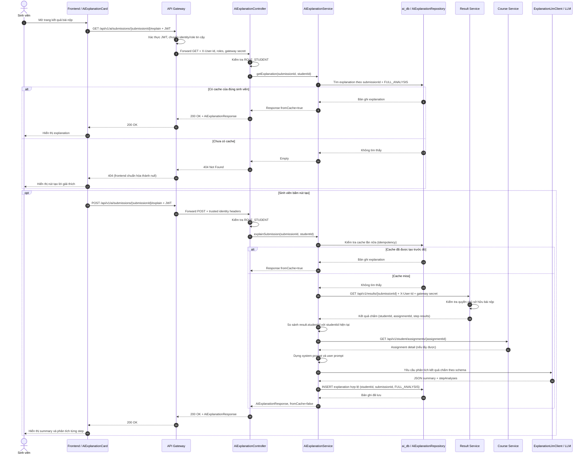
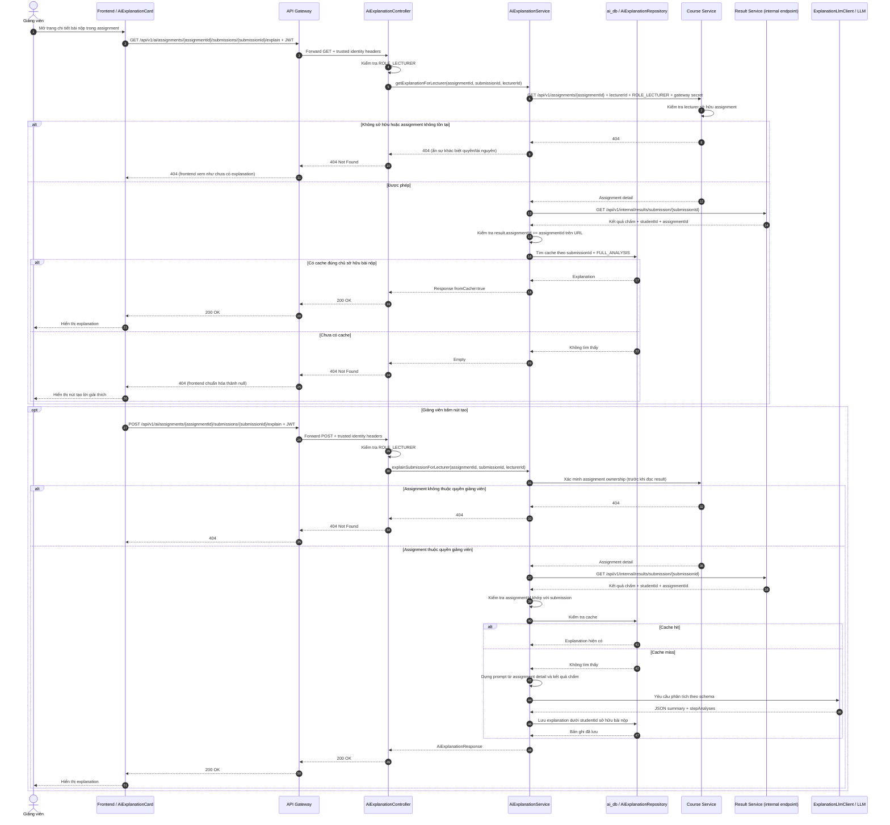

# Tài liệu đầu vào vẽ Sequence Diagram – AI Explain

> Mục đích: tập hợp actor, thành phần, API, dữ liệu, thứ tự xử lý và các nhánh lỗi cần thể hiện khi vẽ sequence diagram cho chức năng AI Explain của sinh viên và giảng viên.
>
> Phạm vi: mô tả theo luồng hiện có trong mã nguồn tại `ai-assistant-service` và frontend. Các luồng student và lecturer dùng chung phần tạo lời giải thích, nhưng có endpoint và quy tắc phân quyền riêng.

## 1. Tóm tắt chức năng

AI Explain tạo lời giải thích cho kết quả chấm của một bài nộp. Frontend chỉ gọi tạo khi người dùng bấm nút; khi mở card, frontend gọi GET để kiểm tra đã có lời giải thích trong cache chưa. POST trả lời từ cache nếu đã tồn tại; nếu chưa, backend lấy dữ liệu kết quả chấm và ngữ cảnh assignment, gọi LLM, lưu kết quả hợp lệ rồi trả về cho frontend.

Một lời giải thích được lưu theo `submissionId` và category `FULL_ANALYSIS`, gắn với `studentId` là chủ sở hữu bài nộp. Vì vậy, lời giải thích do giảng viên tạo có thể được sinh viên của bài nộp đó đọc lại.

## 2. Actor và participant

| Tên trong diagram | Thành phần | Trách nhiệm trong luồng |
| --- | --- | --- |
| `Student` | Sinh viên | Xem lời giải thích cho bài nộp của chính mình; yêu cầu tạo nếu chưa có. |
| `Lecturer` | Giảng viên | Xem hoặc yêu cầu tạo lời giải thích cho bài nộp thuộc assignment do mình sở hữu. |
| `FE` | Web frontend, `AiExplanationCard` và `useAiExplanation` | GET khi card đủ điều kiện hiển thị; POST khi người dùng chủ động tạo; hiển thị trạng thái và kết quả. |
| `GW` | API Gateway | Xác thực JWT qua Keycloak, định tuyến `/api/v1/ai/**`, chuyển identity/role tin cậy tới AI service. |
| `AIC` | `AiExplanationController` | Nhận GET/POST và chặn theo role bằng `@PreAuthorize`. |
| `AIS` | `AiExplanationService` | Kiểm tra cache, kiểm tra quyền theo đối tượng, lấy dữ liệu đầu vào, gọi luồng sinh và ánh xạ kết quả. |
| `AI_DB` | PostgreSQL `ai_db`, repository `AiExplanationRepository` | Đọc/ghi bản ghi `ai_explanations`. |
| `RS` | Result Service | Cung cấp các dòng kết quả chấm và thông tin `studentId`, `assignmentId`. |
| `CS` | Course Service | Cung cấp thông tin assignment; với lecturer, endpoint owner-scoped dùng để xác minh quyền sở hữu assignment. |
| `LLM` | Nhà cung cấp mô hình qua `ExplanationLlmClient` | Tạo JSON có cấu trúc gồm summary và phân tích từng step. |

Không cần đưa Keycloak thành participant riêng nếu diagram chỉ mô tả request từ FE tới gateway; có thể ghi chú rằng GW xác thực JWT qua Keycloak/JWKS.

## 3. API và quyền truy cập

### Sinh viên

| Mục đích | Method và path | Điều kiện chính |
| --- | --- | --- |
| Đọc cache | `GET /api/v1/ai/submissions/{submissionId}/explain` | `ROLE_STUDENT`; lời giải thích phải thuộc bài nộp của user. `404` nghĩa là chưa có cache. |
| Tạo hoặc lấy cache | `POST /api/v1/ai/submissions/{submissionId}/explain` | `ROLE_STUDENT`; phải là chủ sở hữu bài nộp. POST có tính idempotent. |

AI service gọi Result Service qua `GET /api/v1/results/{submissionId}` với `X-User-Id` và `X-Gateway-Secret`. Result Service kiểm tra quyền ở endpoint của nó; AI service tiếp tục so sánh `studentId` trong kết quả với user hiện tại.

Khi cần ngữ cảnh đề bài, AI service gọi Course Service qua `GET /api/v1/student/assignments/{assignmentId}` với identity của sinh viên và gateway secret. Lỗi lấy metadata này được xử lý theo hướng tiếp tục với metadata rỗng vì metadata chỉ làm giàu prompt, không phải điều kiện phân quyền.

### Giảng viên

| Mục đích | Method và path | Điều kiện chính |
| --- | --- | --- |
| Đọc cache | `GET /api/v1/ai/assignments/{assignmentId}/submissions/{submissionId}/explain` | `ROLE_LECTURER`; giảng viên phải sở hữu assignment chứa submission. `404` cũng được dùng khi không có cache hoặc không thể xem assignment/submission đó. |
| Tạo hoặc lấy cache | `POST /api/v1/ai/assignments/{assignmentId}/submissions/{submissionId}/explain` | `ROLE_LECTURER`; xác minh assignment ownership và cặp assignment/submission trước khi đọc dữ liệu chấm. POST có tính idempotent. |

Trước khi đọc dữ liệu chấm, AI service gọi Course Service `GET /api/v1/assignments/{assignmentId}` bằng `X-User-Id` của lecturer, `X-User-Roles: ROLE_LECTURER` và `X-Gateway-Secret`. Endpoint này là phép kiểm tra assignment thuộc quyền giảng viên. Sau đó AI service mới gọi endpoint nội bộ Result Service `GET /api/v1/internal/results/submission/{submissionId}`; endpoint nội bộ này không nhận identity nên thứ tự kiểm tra quyền phải được thể hiện rõ trong diagram. Cuối cùng AI service xác nhận `assignmentId` của kết quả chấm khớp với `assignmentId` trên URL.

## 4. Luồng sinh viên – đọc cache và tạo lời giải thích

Diagram nên phân biệt lần tải card (GET) và hành động người dùng bấm tạo (POST). GET không tự gọi LLM.



## 5. Luồng giảng viên – đọc cache và tạo lời giải thích

Luồng này cần nhấn mạnh rằng quyền được kiểm tra qua assignment trước khi gọi Result Service internal. `assignmentId` và `submissionId` phải cùng trỏ tới một submission thuộc assignment đó.



> Trong diagram giảng viên, có thể rút gọn lần GET và POST thành hai fragment riêng nếu muốn sơ đồ gọn hơn. Dù rút gọn, phải giữ quy tắc: kiểm tra assignment ownership trước khi đọc Result Service internal.

## 6. Dữ liệu vào và dữ liệu trả về

### Dữ liệu dùng để tạo prompt

- `submissionId`, `studentId`, `assignmentId`.
- Assignment detail: tiêu đề/mô tả và cấu hình các step có sẵn từ Course Service.
- Kết quả chấm từ Result Service: trạng thái pass/fail và dữ liệu kết quả từng step.
- `PromptBuilder` tạo system prompt và user prompt; `ExplanationLlmClient` yêu cầu output theo DTO có cấu trúc.

Không mô tả telemetry như một tập hợp đầy đủ các số đo đang được đảm bảo. DTO hiện có `TelemetryAudit`, nhưng frontend type ghi các trường telemetry là placeholder và chưa render ở v1.

### Response của AI service

AI service trả JSON trực tiếp, không bọc trong `ApiResponse`:

```json
{
  "id": "<explanation-id>",
  "submissionId": "<submission-id>",
  "category": "FULL_ANALYSIS",
  "fromCache": false,
  "overallSummary": "<tóm tắt>",
  "stepAnalyses": [
    {
      "stepId": "<step-id>",
      "stepName": "<tên step>",
      "stepType": "<loại step>",
      "passed": false,
      "category": "DEBUG_FAIL",
      "diagnosis": "<chẩn đoán>",
      "suspectedLocation": "<vị trí nghi ngờ>",
      "actionableHints": ["<gợi ý>"] ,
      "learningKeywords": ["<từ khóa>"] ,
      "telemetryAudit": null
    }
  ],
  "createdAt": "<timestamp>"
}
```

Các category phân tích step hiện có là `DEBUG_FAIL` và `OPTIMIZE_PASS`. Response từ cache có `fromCache=true`; một response vừa lưu thành công có `fromCache=false`.

## 7. Nhánh thay thế và lỗi cần cân nhắc trên diagram

| Tình huống | Kết quả/nhánh cần ghi chú |
| --- | --- |
| Chưa có explanation khi GET | AI service trả `404`; frontend chuẩn hóa thành `null` và hiện CTA tạo, không coi đó là lỗi tải dữ liệu. |
| GET/POST tìm thấy cache | Trả ngay bản ghi, không gọi LLM. POST lặp lại cũng trả cache. |
| Sai role | Controller role gate chặn request (thường là `403`). |
| Sinh viên không sở hữu submission | Từ chối request; AI service không trả lời explanation của sinh viên khác. |
| Lecturer không sở hữu assignment | Course Service trả `404`; AI service giữ `404` để không tiết lộ assignment có tồn tại hay không. Không đọc Result Service internal trước bước này. |
| `assignmentId` không khớp submission | AI service trả `404`; không tạo/đọc explanation theo cặp ID sai. |
| Không có grading result | AI service trả `404`. |
| Result Service lỗi hoặc timeout | AI service ánh xạ lỗi dependency thành `502 Bad Gateway` để client có thể thử lại. |
| Không lấy được assignment metadata trên student path | Tiếp tục tạo prompt với metadata không có; đây là context bổ sung. |
| LLM lỗi/không parse được output | Thử strict completion thêm một lần; nếu vẫn không có output hợp lệ, trả kết quả suy giảm không ghi cache để lần sau có thể thử lại. |
| Hai POST đồng thời | Unique index ngăn lưu trùng; request thua cuộc đọc bản ghi vừa được request kia lưu và trả cache. |

## 8. Quy tắc phân quyền và thứ tự xử lý

1. Gateway xác thực JWT và chuyển identity đã xác minh; không tin `studentId`/`lecturerId` do client tự gửi trong body.
2. AI controller kiểm tra role phù hợp với route.
3. Student path dùng endpoint kết quả có identity, sau đó AI service tự đối chiếu owner.
4. Lecturer path xác minh quyền sở hữu assignment qua Course Service trước khi gọi Result Service internal.
5. Lecturer path kiểm tra `assignmentId` trả về từ kết quả chấm khớp với ID trên URL.
6. Dữ liệu cache luôn thuộc `studentId` thực sự sở hữu submission; lecturer không tạo cache đứng tên lecturer.
7. Không đưa JWT hoặc gateway secret vào prompt gửi LLM.

## 9. Trình tự gợi ý khi vẽ

- Vẽ hai sơ đồ riêng: `AI Explain – Student` và `AI Explain – Lecturer`.
- Mỗi sơ đồ thể hiện GET cache và POST tạo bằng fragment `opt`; có thể tách thành diagram nhỏ nếu diagram bị dài.
- Trong POST, dùng fragment `alt Cache hit / Cache miss` để thể hiện idempotency.
- Ở lecturer diagram, dùng `alt Assignment not owned / Authorized` trước lời gọi Result Service internal.
- Thể hiện phần gọi LLM, lưu cache và response về frontend một lần trong nhánh cache miss.
- Dùng mũi tên nét đứt cho response; đánh dấu rõ internal endpoint của Result Service.
- Tên participant/API trong diagram cần giữ khớp với bảng API ở mục 3.

## 10. Tham chiếu mã nguồn

- Backend controller: `web-grading-system-backend-services/ai-assistant-service/src/main/java/vn/edu/ptit/web_grading_system/ai_assistant_service/controller/AiExplanationController.java`
- Backend service: `web-grading-system-backend-services/ai-assistant-service/src/main/java/vn/edu/ptit/web_grading_system/ai_assistant_service/service/AiExplanationService.java`
- Result Service client: `web-grading-system-backend-services/ai-assistant-service/src/main/java/vn/edu/ptit/web_grading_system/ai_assistant_service/client/ResultServiceClient.java`
- Course Service client: `web-grading-system-backend-services/ai-assistant-service/src/main/java/vn/edu/ptit/web_grading_system/ai_assistant_service/client/CourseServiceClient.java`
- Frontend endpoints: `web-grading-system-fe/web-grading-system-fe/src/shared/api/endpoints/aiExplanation.ts`
- Frontend hook: `web-grading-system-fe/web-grading-system-fe/src/shared/hooks/useAiExplanation.ts`
- Frontend card: `web-grading-system-fe/web-grading-system-fe/src/shared/ui/AiExplanationCard.tsx`
- DTO phía frontend: `web-grading-system-fe/web-grading-system-fe/src/shared/types/aiExplanation.ts`

Tài liệu cũ `AI_INTEGRATION_SPECIFICATION.md` mô tả một route explain chung kiểu cũ. Khi vẽ diagram cho implementation hiện tại, ưu tiên các route tách theo audience trong controller và endpoint frontend nêu ở trên.
