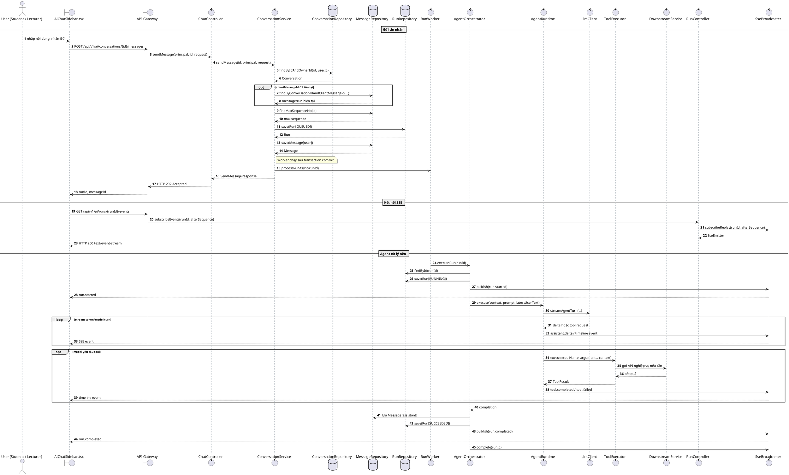

# Hướng dẫn vẽ Sequence Diagram cho AI Assistant Service

Tài liệu mô tả luồng chat AI chính dựa trên backend hiện có và giao diện `AiChatSidebar.tsx`, để dựng sơ đồ tương tự các sequence diagram trong `design-phase.vpp`.

## 1. Phạm vi sơ đồ

Mô tả luồng: người dùng gửi tin nhắn → service tạo `Run` và lưu message → worker xử lý bất đồng bộ → agent gọi model và tool nếu cần → UI nhận tiến độ qua SSE → lưu câu trả lời và đóng run.

Không gộp API quản lý hội thoại, giải thích kết quả bài nộp, hay chi tiết toàn bộ tool nghiệp vụ vào sơ đồ chính. Nếu cần, tách thành sơ đồ riêng để không làm diagram quá rộng.

## 2. Căn cứ từ code

- `AiChatSidebar.handleSend` tạo `clientMessageId`; nếu chưa có hội thoại thì tạo mới, gửi message, lấy `runId`, rồi theo dõi trạng thái/event.
- `ChatController.sendMessage` nhận `POST /api/v1/ai/conversations/{id}/messages`, phản hồi `202 Accepted`.
- `ConversationService.sendMessage` kiểm tra owner, xử lý idempotency bằng `clientMessageId`, lưu `Run[QUEUED]` và user message. Sau transaction commit mới gọi worker. Câu hỏi đầu tiên còn có thể kích hoạt tạo title nền.
- `RunWorker` submit tác vụ vào virtual thread và gọi `AgentOrchestrator.executeRun`.
- `AgentOrchestrator` đổi trạng thái sang `RUNNING`, chuẩn bị context, gọi `AgentRuntime`, lưu kết quả và phát sự kiện kết thúc.
- `AgentRuntime` điều phối model turn, tool call, approval và timeline. Không phải yêu cầu nào cũng gọi tool.
- `RunController` đăng ký SSE tại `GET /api/v1/ai/runs/{id}/events`; `SseBroadcaster` đẩy event tới UI. Timeline có thể replay dựa trên `afterSequence`.

Code tham chiếu:

- `web-grading-system-fe/web-grading-system-fe/src/features/ai-chat/AiChatSidebar.tsx`
- `web-grading-system-fe/web-grading-system-fe/src/features/ai-chat/hooks/useRunEvents.ts`
- `web-grading-system-backend-services/ai-assistant-service/src/main/java/vn/edu/ptit/web_grading_system/ai_assistant_service/controller/ChatController.java`
- `web-grading-system-backend-services/ai-assistant-service/src/main/java/vn/edu/ptit/web_grading_system/ai_assistant_service/service/ConversationService.java`
- `web-grading-system-backend-services/ai-assistant-service/src/main/java/vn/edu/ptit/web_grading_system/ai_assistant_service/orchestrator/RunWorker.java`
- `web-grading-system-backend-services/ai-assistant-service/src/main/java/vn/edu/ptit/web_grading_system/ai_assistant_service/orchestrator/AgentOrchestrator.java`
- `web-grading-system-backend-services/ai-assistant-service/src/main/java/vn/edu/ptit/web_grading_system/ai_assistant_service/orchestrator/AgentRuntime.java`
- `web-grading-system-backend-services/ai-assistant-service/src/main/java/vn/edu/ptit/web_grading_system/ai_assistant_service/controller/RunController.java`
- `web-grading-system-backend-services/ai-assistant-service/src/main/java/vn/edu/ptit/web_grading_system/ai_assistant_service/orchestrator/SseBroadcaster.java`
- `web-grading-system-backend-services/ai-assistant-service/src/main/java/vn/edu/ptit/web_grading_system/ai_assistant_service/service/LlmClient.java`
- `web-grading-system-backend-services/ai-assistant-service/src/main/java/vn/edu/ptit/web_grading_system/ai_assistant_service/tools/ToolExecutor.java`

## 3. Participant cần có

Đặt nhóm UI bên trái, điều phối ở giữa, persistence và hệ thống ngoài bên phải. Danh sách dưới đây là 16 participant lõi, theo thứ tự gợi ý trái sang phải:

| # | Participant hiển thị | UML | Vai trò |
|---:|---|---|---|
| 1 | `User (Student / Lecturer)` | Actor | Người dùng đã đăng nhập |
| 2 | `AiChatSidebar.tsx` | Boundary | Nhập câu hỏi, hiển thị câu trả lời và timeline |
| 3 | `API Gateway` | Boundary | Điểm vào API của frontend; giữ để khớp style diagram hiện hữu |
| 4 | `ChatController` | Control | Endpoint gửi message |
| 5 | `ConversationService` | Control | Kiểm tra hội thoại, lưu message/run, kích hoạt worker |
| 6 | `ConversationRepository` | Database | Kiểm tra hội thoại và owner |
| 7 | `MessageRepository` | Database | Idempotency, thứ tự, lưu message |
| 8 | `RunRepository` | Database | Trạng thái run |
| 9 | `RunWorker` | Control | Chạy tác vụ nền trên virtual thread |
| 10 | `AgentOrchestrator` | Control | Vòng đời run, context và persistence |
| 11 | `AgentRuntime` | Control | Model turn, tool call, approval |
| 12 | `LlmClient` | Control | Gọi/stream model AI |
| 13 | `ToolExecutor` | Control | Chạy tool được chọn |
| 14 | `DownstreamService (Course / Submission)` | External system | API nghiệp vụ được tool gọi khi cần |
| 15 | `RunController` | Control | Endpoint subscribe SSE |
| 16 | `SseBroadcaster` | Control | Gửi event run về subscriber |

Trong ảnh trước, `User` chưa hiện trong vùng canvas nhưng nó nằm trong danh sách participant của sơ đồ. Nếu không kéo được model Actor, tạo Actor bằng palette Sequence Diagram và đặt tên `User (Student / Lecturer)`. `TaskRepository`, `JpaChatMemory`, `RunTimelineService`, `RunEventRepository`, `ConversationTitleWorker` là thành phần thật nhưng chỉ thêm nếu cần mô tả sâu; sơ đồ chính có thể gộp/bỏ chúng.

## 4. Message cần vẽ

Vẽ theo thứ tự từ trên xuống. Call đồng bộ dùng mũi tên đặc, response dùng nét đứt. Dùng `opt` cho nhánh tùy chọn, `loop` cho vòng lặp và `alt` cho kết quả thay thế.

### A. Gửi tin nhắn và tạo run

1. `User → AiChatSidebar.tsx`: `Nhập nội dung và nhấn Gửi`.
2. Chỉ khi chưa có hội thoại: `UI → API Gateway → ChatController`: `POST /api/v1/ai/conversations`.
3. `ChatController → ConversationService`: `createConversation(principal, request)`.
4. `ConversationService → ConversationRepository`: `save(Conversation[ownerId, title?])`; trả conversation ID về UI.
5. `UI → API Gateway → ChatController`: `POST /api/v1/ai/conversations/{id}/messages {text, clientMessageId}`.
6. `ChatController → ConversationService`: `sendMessage(conversationId, principal, request)`.
7. `ConversationService → ConversationRepository`: `findByIdAndOwnerId(id, userId)`; trả `Conversation`.
8. Thêm `opt [clientMessageId đã tồn tại]`: service gọi `MessageRepository.findByConversationIdAndClientMessageId(...)`; nếu tìm thấy thì trả run/message ID cũ, không tạo run mới.
9. Nhánh còn lại: `ConversationService → MessageRepository`: `findMaxSequenceNo(conversationId)`.
10. `ConversationService → RunRepository`: `save(Run[QUEUED, callerEmail, callerRoles])`.
11. `ConversationService → MessageRepository`: `save(Message[role=user, text, runId, sequenceNo])`.
12. Note cạnh service: `Sau khi transaction commit`.
13. `ConversationService →> RunWorker`: `processRunAsync(runId)` (asynchronous call).
14. `ConversationService --> ChatController --> Gateway --> UI`: `202 Accepted {conversationId, runId, messageId}`. Response này về trước khi AI hoàn tất.

### B. Kết nối SSE

15. `UI → API Gateway → RunController`: `GET /api/v1/ai/runs/{runId}/events?afterSequence=...`.
16. `RunController → SseBroadcaster`: `subscribeReplay(runId, afterSequence, ...)` (hoặc `subscribe` khi replay timeline không bật).
17. `SseBroadcaster --> RunController --> UI`: `SseEmitter / HTTP 200 text/event-stream`.

Đặt đoạn subscribe riêng, gần UI. Worker có thể chạy gần như đồng thời, không cần đợi UI đăng ký SSE xong.

### C. Agent chạy nền

18. `RunWorker → AgentOrchestrator`: `executeRun(runId)`.
19. `AgentOrchestrator → RunRepository`: `findById(runId)`; nếu không còn `QUEUED` thì bỏ qua.
20. `AgentOrchestrator → RunRepository`: `save(Run[RUNNING, startedAt])`.
21. `AgentOrchestrator → SseBroadcaster → UI`: `run.started`.
22. `AgentOrchestrator → ConversationRepository`: lấy conversation; task đang hoạt động có thể được đọc nếu có.
23. `AgentOrchestrator → MessageRepository`: lấy user message thuộc run.
24. `AgentOrchestrator → AgentRuntime`: `execute(agentContext, systemPrompt, latestUserText, callbacks, isCancelled)`.
25. `AgentRuntime → LlmClient`: stream model với prompt/context và các tool được phép.
26. Trong lúc stream, `AgentRuntime → SseBroadcaster → UI`: `assistant.delta` hoặc event timeline tương ứng; UI ghép nội dung thành câu trả lời.

### D. Gọi tool (tùy chọn)

Dùng `opt [Model yêu cầu tool]` cho nhánh sau; nếu muốn biểu diễn nhiều lượt thì đặt trong `loop [còn tool call và run chưa bị hủy]`.

27. `AgentRuntime → SseBroadcaster → UI`: event tiến độ như `tool.started`.
28. `AgentRuntime → ToolExecutor`: `execute(toolName, arguments, agentContext)`.
29. `ToolExecutor → DownstreamService`: gọi Feign/API nghiệp vụ nếu tool cần dịch vụ ngoài. Tool khác có thể chỉ truy vấn dữ liệu nội bộ.
30. `DownstreamService --> ToolExecutor`: DTO hoặc lỗi nghiệp vụ.
31. `ToolExecutor --> AgentRuntime`: `ToolResult`.
32. `AgentRuntime → SseBroadcaster → UI`: `tool.completed` hoặc `tool.failed`; sau đó kết quả được đưa lại vào context model.
33. Với thao tác ghi cần duyệt, thêm `opt [cần user approval]`: tạo thao tác chờ duyệt; user xác nhận/từ chối trong tin nhắn tiếp theo rồi agent mới thực thi/hủy. Không giả định mọi tool đều chạy ngay.

### E. Kết thúc

34. `AgentRuntime --> AgentOrchestrator`: completion text.
35. `AgentOrchestrator → MessageRepository` (hoặc lifeline `JpaChatMemory` nếu thể hiện riêng): lưu assistant message.
36. `AgentOrchestrator → RunRepository`: lưu `SUCCEEDED`, `finishedAt`.
37. `AgentOrchestrator → SseBroadcaster → UI`: `run.completed`.
38. `AgentOrchestrator → SseBroadcaster`: `complete(runId)`; SSE đóng.
39. UI tải lại messages/conversations nếu cần và hiển thị câu trả lời hoàn chỉnh.

Bao phần kết thúc trong `alt`:

- `[Thành công]`: bước 34–38.
- `[Lỗi model/tool/runtime]`: lưu `FAILED`, lưu thông báo assistant nếu có thể, phát `assistant.replace` và `run.failed`, rồi complete SSE.
- `[User hủy]`: UI gọi `POST /api/v1/ai/runs/{runId}/cancel`; backend phát `run.cancelled` và complete SSE.

Không cần chép mọi mã lỗi. Ghi note `provider failure / tool failure / empty response` là đủ.

## 5. Dựng và tạo style trong Visual Paradigm

1. Mở `design-phase.vpp`. Để theo style cũ, duplicate/copy một Sequence Diagram có bố cục rõ, đổi tên bản sao thành `user-chat-ai-assistant-sequence`. Nếu không muốn dùng bản sao, tạo Sequence Diagram mới trong cùng project rồi đặt style thủ công.
2. Bảo đảm participant nằm trên cùng một hàng; UI/Gateway ở trái, controller/service ở giữa, repository và tích hợp ngoài về phải. Đặt `RunController`/`SseBroadcaster` gần Gateway để đường SSE không cắt qua luồng chính.
3. Giữ nền trắng, lifeline viền xám đậm/nền xám nhạt giống diagram hiện hữu. Bật đánh số message nếu sơ đồ mẫu đang dùng sequence numbering.
4. Thả 16 participant theo nhóm logic, sau đó sắp xếp thủ công, không giữ thứ tự alphabetic mặc định. Tạo Actor `User` bằng palette nếu model import không kéo được.
5. Dùng combined fragment: `opt` cho idempotency và tool, `loop` cho agent/tool nhiều lượt, `alt` cho success/failure/cancel. Đặt endpoint và tên method ngắn trên message.
6. Thể hiện `RunWorker` là asynchronous call. Vẽ response HTTP `202` quay về UI trước khi các event AI hoàn tất.
7. Nếu canvas quá rộng, tách thành `user-chat-ai-assistant-sequence` (submit/run/SSE) và `user-chat-ai-assistant-tool-sequence` (tool/approval). Không thu nhỏ chữ quá mức.

## 6. Lưu ý về bản diagram cũ

- Worker được đăng ký chạy sau transaction commit, không chạy AI đồng bộ trong transaction của `sendMessage`.
- Tool call là nhánh tùy chọn, không phải mọi chat đều gọi tool.
- SSE là endpoint riêng sau khi UI nhận `runId`; có thể replay từ `afterSequence`.
- Timeline hiện có các event phong phú như `tool.started`, `tool.completed`, `reasoning.*`, `assistant.delta`; đừng thể hiện tất cả thành một message `tool.call` nếu cần khớp UI.
- Có status/event khác nhau cho hoàn tất, lỗi và hủy.
- `ConversationTitleWorker` tạo title nền cho hội thoại đầu tiên; thêm vào sơ đồ chỉ khi cần mô tả title.
- Không nhầm sơ đồ chat này với `student-ai-explain-submission-sequence`.

## 7. PlantUML tham khảo

Đây là khung logic để đối chiếu khi vẽ trong Visual Paradigm; có thể mở rộng nhánh tool/error theo mục 4.

